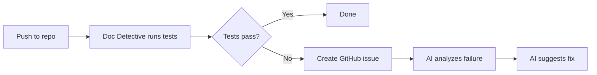

When a test fails, Doc Detective's GitHub Action can open an issue with the results and mention an AI agent in it. The agent analyzes the failure and suggests a fix. You review the suggestion and decide what to change.

## How the handoff works

The handoff connects three components:

1. **Automated testing**: Doc Detective runs on every push or pull request, catching documentation that no longer matches your product.
2. **Failure detection**: When tests fail, the GitHub Action opens an issue with a summary of the failures, or updates the open one.
3. **AI diagnosis**: The issue mentions an AI assistant that analyzes the failure and suggests fixes.



A person reviews every change before it lands. When documentation drifts from your product, the issue surfaces the problem with the agent's analysis, and you decide on the fix. Tests can also update screenshots and command outputs. With `create_pr_on_change`, the action opens a pull request with those updates, and you review it before merging.

## Set up the handoff

Configure your workflow to create an issue that mentions an AI assistant when tests fail:

```yaml
name: doc-detective
on:
  push:
    branches: [main]

jobs:
  doc-tests:
    runs-on: ubuntu-latest
    permissions:
      contents: read
      issues: write
    steps:
      - uses: actions/checkout@v4
      - uses: actions/setup-node@v4
        with:
          node-version: 24
      - uses: doc-detective/github-action@v2
        with:
          input: ./docs
          create_issue_on_fail: true
          token: ${{ secrets.DOC_DETECTIVE_ISSUE_TOKEN }}
          issue_mentions: claude
          issue_prompt: |
            Analyze these Doc Detective test failures. For each failure:
            1. Identify the root cause (documentation drift, broken link, UI change, etc.)
            2. Suggest a specific fix with the exact text or code changes needed
            3. Flag if the issue requires product changes vs documentation changes
```

Doc Detective 5 needs Node.js 24.15 or later, so the workflow sets up Node.js 24 before the action. This configuration:
- Runs tests against the `./docs` directory on every push to `main`
- Creates a GitHub issue when any test fails, or updates the open one from an earlier run, using the token in the `DOC_DETECTIVE_ISSUE_TOKEN` secret
- Mentions Claude in the issue with a detailed diagnostic prompt
- Passes the run's Markdown summary to Claude for analysis

Claude Code answers from a GitHub Actions workflow that starts when an issue opens. GitHub doesn't start workflows for events that the default `GITHUB_TOKEN` creates. An issue the action opens with that token therefore never reaches Claude. Set `token` to one of these:

- A fine-grained personal access token that can write issues, stored as a repository secret. Its owner needs write access to the repository, because Claude Code ignores issues from users without it.
- A GitHub App token that the workflow generates on each run, for example with `actions/create-github-app-token`. Installation tokens expire after an hour, so don't store one as a secret. Claude Code ignores bots by default, so add the app's bot to `allowed_bots` in the Claude Code workflow.

The action also opens pull requests with `token`. If you set `create_pr_on_change`, as the [weekly example](#example-weekly-docs-health-check) does, the token also needs **Pull requests: write**.

The example runs on pushes to `main`, not on `pull_request`. By default, a pull request from a fork gets no secrets and a read-only `GITHUB_TOKEN`, so the action can't open the issue there. A private repository can change that under **Fork pull request workflows**, as [Tests are code](/docs/ci/github-action#tests-are-code) explains. To check pull requests, keep a separate `pull_request` workflow without `create_issue_on_fail`.

## Craft effective prompts

The `issue_prompt` input determines how the AI assistants you mention analyze failures. A good prompt produces actionable suggestions rather than generic advice.

### Prompt structure

Build your prompt around three elements:

| Element | Purpose | Example |
|---------|---------|---------|
| **Context** | Tell the AI what kind of documentation this is | "These tests validate API documentation for a REST service." |
| **Task** | Define what analysis you want | "Identify why each test failed and whether the fix belongs in docs or code." |
| **Format** | Specify how to structure the response | "For each failure, provide the file path, line number, and suggested edit." |

### Example prompts

**For API documentation:**

```yaml
issue_prompt: |
  These tests validate API documentation. For each failure:
  - Check if the API endpoint, request format, or response changed
  - Provide the corrected curl command or code example
  - Note if this suggests an undocumented API change
```

**For procedural documentation:**

```yaml
issue_prompt: |
  These tests validate step-by-step procedures. For each failure:
  - Identify which step broke and why
  - Check if the UI, command output, or workflow changed
  - Suggest updated instructions with exact wording
```

**For screenshot tests:**

```yaml
issue_prompt: |
  These visual regression tests compare screenshots against baselines. For each failure:
  - Describe what changed visually
  - Assess if this is a cosmetic change, feature change, or bug
  - Recommend whether to update the baseline or report a product issue
```

### Prompt variables

Use these variables in your prompt or issue body:

| Variable | Expands to |
|----------|------------|
| `$SUMMARY` | The run's Markdown summary, from the run folder's `testResults.md`. The default `issue_body` uses it. |
| `$RESULTS` | Full test results as a JSON code block |
| `$RUN_URL` | URL of the GitHub Actions workflow run |
| `$PROMPT` | The prompt text (useful in custom `issue_body` templates) |

## Choose an AI assistant

List assistants in the `issue_mentions` input. Each one behaves differently. Choose based on your workflow:

| Assistant | Best for | Setup required |
|-------------|----------|----------------|
| `claude` | Deep analysis of complex failures | Install the Claude GitHub app and the [Claude Code Action](https://github.com/anthropics/claude-code-action) workflow, and set `token` |
| `copilot` | Quick triage within GitHub | Enable Copilot for your repo |
| `promptless` | Automated documentation PRs | Connect repo to Promptless |
| `cursor` | Developer-focused code suggestions | Install Cursor GitHub app |
| `dosu` | Issue management and tracking | Install Dosu app |

For every supported assistant, see [AI issue mentions](/docs/ci/issue-mentions). Mention more than one to get multiple perspectives:

```yaml
issue_mentions: claude,copilot
```

## Advanced configuration

### Custom issue templates

Override the default issue body to structure how results appear:

```yaml
issue_body: |
  ## Test Failure Report
  
  **Workflow run:** $RUN_URL
  
  ### Test Results
  $RESULTS
  
  ### Analysis Request
  $PROMPT
```

### Scheduled runs

Run tests on a schedule to catch drift before it reaches production:

```yaml
on:
  schedule:
    - cron: '0 6 * * *'  # Daily at 6 AM UTC
  push:
    branches: [main]
```

### Auto-assign for triage

Route issues to specific team members:

```yaml
issue_assignees: docs-team-lead,qa-engineer
issue_labels: doc-detective,needs-triage,automated
```

## Example: weekly docs health check

This workflow combines scheduled runs, AI diagnosis, and automatic PR creation:

```yaml
name: doc-detective-health-check
on:
  schedule:
    - cron: '0 6 * * 1'  # Weekly on Monday
  workflow_dispatch:  # Allow manual triggers

jobs:
  test-and-triage:
    runs-on: ubuntu-latest
    permissions:
      contents: write
      pull-requests: write
      issues: write
    
    steps:
      - uses: actions/checkout@v4
      
      - uses: actions/setup-node@v4
        with:
          node-version: 24
      
      - uses: doc-detective/github-action@v2
        with:
          input: ./docs
          create_issue_on_fail: true
          create_pr_on_change: true
          pr_paths: ./docs
          token: ${{ secrets.DOC_DETECTIVE_ISSUE_TOKEN }}
          issue_mentions: claude,promptless
          issue_prompt: |
            Analyze these documentation test failures and provide:
            1. Root cause for each failure
            2. Specific text changes to fix the documentation
            3. Whether any failures indicate product bugs vs doc bugs
            
            Format your response as a checklist the docs team can work through.
          
          issue_title: "Weekly docs health check: failures detected"
          issue_labels: doc-detective,automated,weekly-check
          
          pr_title: "Doc Detective: Updated screenshots and outputs"
          pr_labels: doc-detective,automated,for-review
```

This workflow:
- Runs weekly to catch gradual documentation drift
- Keeps one issue current with Claude and Promptless analysis while tests fail
- Opens or updates one PR when tests change screenshots or command outputs under `docs`
- Labels everything for straightforward filtering and triage
